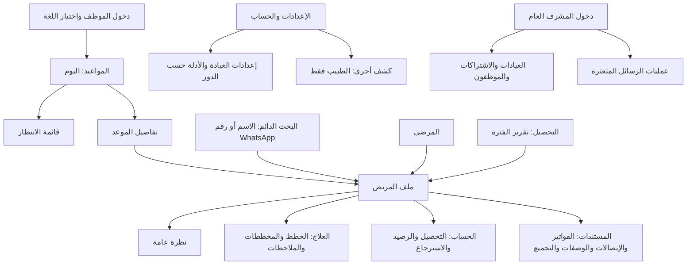

# المرحلة 2 — تجربة الاستخدام

## اختيار التاريخ والوقت عبر واتساب — معتمد 2026-10-04

وضح المستخدم التسلسل: يختار المريض التاريخ في واتساب ← يجلب النظام
المواعيد المتاحة لذلك التاريخ ← يختار المريض وقتًا ← يرسل طلب الحجز
للاستقبال. ليست رسالة نص حر يحدد بعدها الموظف التاريخ والوقت من الصفر.
قائمة الأوقات من الخادم بحسب توقيت العيادة وفحص كامل المدة وتعارض الطبيب
والمريض؛ عند تأكيد الموظف يعاد الفحص لأن التوفر قابل للتغير. اختيار المريض
لا ينشئ موعدًا نهائيًا. وجهة الطلب الاستقبال؛ صلاحية تأكيد الطبيب المعتمدة
سابقًا باقية، دون افتراض إرسال إشعار جديد للطبيب أو آلية تعيين المستلمين.

النموذج frontend-whatsapp-booking-requests.html حُدث ليعرض ملخص التاريخ/
الوقت المختارين مسبقًا ووقتًا مملوءًا، بدل طلب عام. هذا جانب الاستقبال فقط؛
اختيار التاريخ/عرض الأوقات داخل واتساب غير منفذ ولا تثبت محاكاته توفرًا فعليًا.
التاريخ الصحيح والمدة والطبيب وهوية المريض وسلامة الخيارات عند تغيّر التوفر
تحتاج عقد تفاعل محدد. لا اختيار ضمني لمدة الحجز أو للطبيب، ولا حجز مؤقت
حصري أو NLP/AI أو تقنية WhatsApp Flow معتمدة؛ هذه قرارات منفصلة.
رد زر الحضور لموعد موجود يبقى تأكيدًا مباشرًا كما القرار السابق. Backend
الحالي لا يدعم مسار الاختيار هذا؛ الحجز الآلي القديم يحتاج استبدالًا لاحقًا.
تحقق syntax للتعديل وdiff الوثائق فقط؛ لا backend/API/DB أو browser QA.
التالي: تصميم رحلة المريض لاختيار التاريخ/الأوقات وتحديد الطبيب والمدة
بخيارات المستخدم قبل اعتماد تقنية واتساب أو تنفيذ عقد جديد.

## نموذج مراجعة طلب حجز واتساب — مقترح 2026-10-04

أُعد نموذج مستقل frontend-whatsapp-booking-requests.html داخل مجلد Desktop
للتصميم. يعرض طلبين وهميين، رسالة المريض الأصلية، هوية مسجلة/مرسل غير
مسجل، واختيار طبيب/مدة/وقت ثم مراجعة وتأكيد محاكاة. لا تغيير حالة طلب أو
إنشاء موعد/مريض أو إرسال رسالة فعلية. المرسل غير المسجل يحتاج تحديد
هوية/إضافة مريض قبل الحجز؛ لا إنشاء تلقائي من الرسالة. هذا النموذج يشرح
نقطة المراجعة البشرية فقط؛ مسار البحث/الإضافة الكامل قائم في نموذج الحجز
السابق ولم يُربط فعليًا بهذا الملف بعد. الأوقات ثابتة للتوضيح، ليست توفرًا.

الواجهة عربية مع فاتح/داكن؛ النسخة الفرنسية والثيمات وحالات التزامن/الفشل
متبقية. موقع الطلبات داخل صندوق العيادة أو جدول اليوم مقترح لم يعتمد.
لا افتراض أن كل رسالة واتساب طلب حجز أو وجود تفسير نص آلي؛ تحديد نوع
الرسالة وطريقة إنشاء الطلب والتخزين والعقد تحتاج خيارات مع المستخدم.
المصدر الحالي يدعم زر حضور موعد موجود فقط، والحجز الآلي القديم مخالف
للتدفق الجديد ولم يتغير بعد. إعادة فحص التوفر عند تأكيد الموظف مطلوبة.
تحقق المصدر: node --check، IDs فريدة وعدم وجود fetch/localStorage؛ لا
معاينة browser أو اختبار UI. الوثائق فقط داخل المنتج، لا API/DB تغييرات.
التالي: مراجعة النموذج وتحديد مكان طلبات الحجز قبل عقد التخزين والتنفيذ؛
شاشة الدخول ما زالت ضمن تخطيط الشريحة الأولى ولم تُستبدل أو تُنفذ.

## تأكيد حضور موعد موجود من واتساب — معتمد 2026-10-04

اختار المستخدم تسجيل تأكيد الحضور مباشرة من رد المريض على تذكير موعد
محجوز مسبقًا، دون انتظار الاستقبال/الطبيب. هذا تأكيد حضور، لا إنشاء حجز
جديد: طلب الحجز الجديد عبر واتساب يحتاج تأكيد الموظف كما القرار السابق.
لم يُغيَّر قرار الإلغاء أو توسيع نطاق الموافقة لصندوق طلبات الموظفين.

تدقيق الباك إند: WhatsAppInboundProcessor في inbound-processor.ts يعالج
confirm:<appointmentId> من button_reply أو template button payload؛ يطابق
رقم المريض النشط وعيادته والموعد، ويتجاهل الموعد الماضي. يحول SCHEDULED
إلى CONFIRMED مع source=WHATSAPP_CONFIRM ويجهز رسالة الشكر داخل المعاملة.
إعادة التأكيد لا تكرر التغيير/رسالة الشكر عبر updateMany الشرطي. هذا مطابق
لقرار التأكيد المباشر للأزرار؛ قراءة المصدر لا تعادل اختبار تشغيل الآن.

مهم: النص الحر «سأحضر» لا يُفسر حاليًا؛ parseAppointmentReply يرجع null
لرسالة بلا payload معروف. ذكر العبارة في النقاش يوضح قصد الحضور، ولا يثبت
دعم free-text أو إذن إضافة NLP/AI. UI يستخدم زر تأكيد واضح مرتبط بالموعد؛
إضافة قبول نص حر وتحديد الموعد المقصود تحتاج قرارًا مستقلًا إذا طُلبت.
طلبات الحجز الجديدة من رسائل واتساب أيضًا ليس لها تدفق مراجعة موظف في
هذا processor؛ ignore رسالة غير معروفة لا ينشئ طلب حجز. الفجوة موثقة.
التالي: تصميم عرض طلب حجز واتساب للمراجعة البشرية دون اعتماد تخزين جديد
أو حجز تلقائي، ثم متابعة تخطيط أول شريحة. لا API/DB/runtime تغييرات هنا.

## تصحيح تدفق الحجز من واتساب — معتمد 2026-10-04

صحح المستخدم الفرض السابق: النظام لا يحجز تلقائيًا بسبب فراغ موعد أو
مطابقة قائمة الانتظار؛ يلزم استقبال رسالة واتساب، والتأكيد من الاستقبال
أو الطبيب. التدفق المعتمد: رسالة المريض ← طلب يحتاج مراجعة بشرية ← تأكيد
الحجز من موظف مخول ← إعادة تحقق الطبيب/المريض/المدة/الدوام وإنشاء الموعد.
لا موعد مكتمل أو رسالة نجاح بالحجز قبل تأكيد الموظف ونجاح العملية.
اختيار المرشح التالي وحجزه تلقائيًا المقترح سابقًا غير معتمد ومُلغى كخيار
للتدفق الحالي. لا نفترض موافقة المستخدم على إرسال عروض واتساب تلقائية.

كود waitlist-processor الحالي يحجز من مهمة الإلغاء مباشرة؛ هذا سلوك قديم
مخالف للتوضيح الجديد، يحتاج تعديلًا لاحقًا ولم يتغير هنا. checklists التاريخية
المكتملة تصف التنفيذ القديم فقط ولا تعد موافقة على استمراره. قبل تعديل
المنتج يلزم تحديد طريقة عرض طلب واتساب وتنفيذه وعقده ضمن حدود الرسائل.
لا ندخل طلبًا جديدًا في enum AppointmentStatus افتراضًا؛ شكل التخزين قرار
معماري مستقل. ورود رسالة لا يحجز الوقت حصريًا بلا سياسة معتمدة، ويعاد
فحص التوفر عند الإجراء البشري. تبقى قاعدة الموافقة في صندوق طلبات الموظفين
منفصلة عن التنفيذ المؤكد من الجهة المرسلة كما وافق المستخدم سابقًا.

نطاق هذا التصحيح: إنشاء حجز من واتساب/قائمة الانتظار. رد المريض على تذكير موعد موجود يسجل الحضور مباشرة وفق القرار اللاحق؛
التأكيد البشري يخص طلب الحجز الجديد. لا نعمم هذا على الإلغاء. لا API/DB/runtime تغييرات.
نطاق رد التذكير حُسم لاحقًا: تأكيد مباشر؛ التالي تصميم طلب واتساب للمراجعة.

2026-10-04: user found booking-dialog transparency distracting. Standalone
booking dialog now has a 98%-opaque light/dark surface with 20px backdrop blur;
all booking/add-patient/review screens share it. General page glass unchanged.
JS syntax/source checked; rendered visual review remains pending. No product edits.

## نموذج مسار الحجز وإضافة المريض — مقترح للمراجعة 2026-10-04

زر الحجز في frontend-day-schedule.html يفتح الآن مسارًا تجريبيًا كاملًا؛
المنطق في ملف frontend-booking-demo.js المجاور. بحث اسم/هاتف مع مراجعة
هوية المريض، اختيار طبيب/يوم/مدة5–240/وقت/ملاحظة، مراجعة ثم تأكيد تجريبي.
الأوقات تفحص كامل المدة داخل دوام وهمي09:00–17:00؛ تمنع تداخل الطبيب
وتداخل المريض عبر الطبيبين، وتسمح بانتهاء موعد عند بدء التالي. مرشحات كل5
دقائق fixture للنموذج فقط، لا سياسة API معتمدة. الأيام الأخرى بياناتها وهمية
فارغة، والجدول الرئيسي يعرض2026-10-04 فقط؛ لا تقويم تواريخ فعلي بعد.
إضافة المريض في الحوار نفسه: شاشة واحدة نشطة، مسودة الحجز محفوظة، الاسم
والهاتف فقط؛ عند تكرار الهاتف تُعرض الهوية ويُختار السجل بقرار المستخدم.
الحفظ التجريبي يحدد المريض؛ إلغاء الإضافة يعود للحجز. تأكيد الحجز يفحص
التوفر مجددًا ويضيف بطاقة ليوم العرض إذا طابقه؛ لا سجل حقيقي أو localStorage.
يتبع الثيم والوضع واللغة؛ صياغة النموذج/layout مقترحات، لا معمارية جديدة.

تحقق فعلي: node --check للملف؛ فحص حسابي لمنع تداخل الطبيب، والمريض عبر
طبيب آخر، والتجاور الدقيق، وحدود الدوام، وعزل التاريخ والمدة240. هذه اختبارات
منطق نموذج وليست اختبارات DB/تزامن أو QA browser. لا معاينة browser أو
إثبات keyboard/zoom/font/contrast؛ القيود السابقة ما زالت محترمة.
المتبقي: مراجعة المستخدم للحجز والإضافة ثم تدقيق عقد التوفر بهوية المريض
ومنع التداخل في الخادم؛ لا إذن API/DB/dependencies أو تنفيذ المنتج في هذه الدفعة.

## قاعدة توفر الحجز — توضيح المستخدم المعتمد 2026-10-04

المستخدم طلب تبسيط الحجز حول الطبيب المحدد ومدة الموعد، دون إظهار مفهوم
خطوة بدايات الأوقات كقرار للمستخدم. تعرض الواجهة فقط أوقات الطبيب التي تتسع
لكامل المدة داخل الدوام، ولا يتداخل موعدان غير ملغيين للطبيب نفسه، ولا يمتد
موعد إلى بداية موعد آخر. يسمح بانتهاء موعد لحظة بدء التالي (فترات [start,end)).
المريض لا يُحجز عند طبيبين في الوقت نفسه؛ فحص تداخل المريض يشمل جميع أطباء
العيادة، مع فحص تداخل الطبيب حتى لو اختلف المريض. هذه قاعدة حجز لا مجرد رسم.

الخادم يعيد التحقق عند الإنشاء لأن التوفر قد يتغير بعد القراءة؛ عند التعارض
تبقى مسودة الحجز ويُطلب اختيار وقت متاح آخر. تعرض الأوقات بتوقيت العيادة.
منع تداخل الطبيب قائم حسب spec06؛ منع تداخل المريض بين طبيبين يحتاج تدقيق
الخدمة/قيود المعاملة واختبارات التزامن قبل الادعاء بأنه منفذ. توافق slots مع
هوية المريض المختار وتفاصيل العقد لم تُنفذ أو تُحسم ضمن هذه الدفعة.
لا اعتماد ضمني لفاصل15 دقيقة أو خطوة تساوي المدة أو مكتبة جديدة. لا نكرر
سؤال الخطوة للمستخدم؛ الأولوية الآن نموذج حجز بديهي: المريض، الطبيب، اليوم،
المدة، الأوقات المناسبة، ثم مراجعة وتأكيد؛ زر إضافة المريض المعتمد يبقى ظاهرًا.
هذه وثائق تخطيط فقط؛ لا تغيير API/DB/runtime. التالي إعداد نموذج مسار الحجز
مع إضافة المريض والحفاظ على المدخلات، ثم مراجعة العقد التقني اللازم.

2026-10-04: user requested a light appointment-card background to distinguish
cards from the schedule. User subsequently explicitly requested the exact booking-button color for
appointment cards. Prototype now uses solid active primary (blue #1558C0),
matching booking button in both modes; previous pale/mixed fills superseded.
Name/time/status/medical warning use white on blue/olive/petrol and dark #172D48
on pale aqua, matching primary-button contrast. Medical alert text/icon retained.
Exact solid fill requested; final visual review still pending. Full
border and proportional geometry preserved; no status-color or product changes.
CSS/source checked; JavaScript unchanged. Rendered contrast/visual review remains pending.
Next: booking workflow prototype under user-approved doctor/patient nonoverlap rules;
no further user-facing slot-step question. See current clarification above.

## تعديلات جدول اليوم المطلوبة — معتمدة 2026-10-04

طلب المستخدم وقتًا عند كل خط في المحور، وزر فلترة لطبيب محدد، وحدًا حول
كامل بطاقة الموعد. طُبقت في النموذج المستقل frontend-day-schedule.html:
تسمية كل15 دقيقة من09:00 إلى16:45 مع إبراز الساعات؛ زر يفتح منتقي جميع
الأطباء/طبيب واحد، إخفاء العمود الآخر وتحديث العدد ومسح تفاصيل الموعد المخفي؛
حد1px بلون الثيم حول البطاقة كاملة بدل الحافة الجانبية وحدها. تبقى حدود
الأسطح العامة الرمادية الهادئة كما هي، والموضع/الارتفاع متناسبين بالدقائق.
هذا اعتماد UI محدود، لا تغيير candidate-slot step أو معمارية أو API.
تحقق syntax JavaScript ومراجع IDs وحسابات المحور والتصفية من المصدر؛
لم تتم معاينة browser للتعديل. التالي مراجعة المستخدم ثم عقد الأوقات المتاحة.

## نموذج جدول اليوم — للمراجعة 2026-10-04

أُعد نموذج مستقل في `C:/Users/ayman/Desktop/dental-UI-design/frontend-day-schedule.html`.
يعرض سبعة مواعيد وهمية بمدد15/30/45/60/90 دقيقة وبدايات غير محصورة برأس الساعة،
بموضع وارتفاع متناسبين بدقة. عمودا الطبيبين، لوحة التفاصيل، ومقياس156/216px
لكل ساعة مقترحات بصرية للمراجعة وليست قرارات معمارية أو مقياسًا ثابتًا للمنتج.
الموعد القصير يتيح الاسم الكامل والوقت والحالة والتنبيه عبر اسمه المتاح ولوحة التفاصيل؛
لا نزيد ارتفاعه خلاف مدته. العربية/الفرنسية، أربعة ثيمات، فاتح/داكن؛ الافتراضي أزرق فاتح.
زر الحجز يعرض شرح نطاق النموذج فقط؛ لا يوجد حجز أو إنشاء مريض أو حفظ مظهر فعلي.
لا سحب/تمديد لتعديل موعد، ولا اعتماد مكتبة تقويم أو تغيير API/DB.
تحقق المصدر: syntax JavaScript، IDs فريدة، حسابات الموضع/الارتفاع ونسب المدد
وعدم تداخل البيانات الوهمية. لم تتم معاينة المتصفح أو تحقق اللمس/الكيبورد/200%zoom؛
وصول file:// عبر الأداة مرفوض سابقًا، ولم يُستخدم التفاف. المدد الدنيا5دقائق
والتنبيهات الطويلة والتداخل التاريخي تحتاج حالات مراجعة إضافية قبل قبول المنتج.
التالي: مراجعة المستخدم للنموذج، ثم حسم خطوة بدايات الأوقات المتاحة بخيارات منفصلة.

2026-10-04: user requested hourly day grid with appointment position/length
proportional to exact start/duration minutes. No hourly booking restriction or
drag-to-edit implied; candidate-slot step remains separate. See design.md/slice plan.

2026-10-04: add-patient button/modal within booking approved; existing name/phone
create contract reused. Resume preserved booking on success, review duplicate
identity on409; no nested dialogs or patient recreation after booking failure.
Planning only; details in design.md/first-slice plan.

2026-10-04: booking-duration-aware slot read approved. Current API unchanged;
optional-duration fallback/grid semantics and contract tests still need review.
Scope in design.md/first-slice plan; no implementation in this planning batch.

2026-10-04: appointment day-read extension with patient name/phone/medicalAlerts
approved; contract/runtime not implemented. Slots audit confirms configured
slot duration only, requiring a separate booking-duration decision. See slice plan.

2026-10-04: user-selected first slice login → day schedule → booking.
[Slice plan](FRONTEND_FIRST_SLICE.md) records audited contracts and pending identity/duration
choices. Prior read/print slice is not selected; no implementation in this batch.

2026-10-04: appearance save failure keeps new preview with persistent not-saved
notice and manual retry. Confirmed account preference remains authoritative;
no automatic mutation replay. See design.md/appearance contract; docs only.

2026-10-04: nullable account appearance fields with effective blue/light defaults
approved; saved explicit choice wins, no appearance backfill/write-on-read.
Detailed DTO/save behavior pending; no DB/API implementation. See design.md.

2026-10-04: extending existing preference PATCH approved; no separate appearance
endpoint. Preserve old locale request/initializeOnly compatibility. Storage/field
semantics/save behavior still pending. No API/DB/OpenAPI implementation.

2026-10-04: user explicitly chose blue/light as the default for accounts without
saved appearance. Saved account choice takes precedence. Default approved;
preference endpoint/storage/save behavior still needs review. No runtime changes.

2026-10-04: [appearance contract draft](FRONTEND_APPEARANCE_CONTRACT.md) prepared from current
locale-only DTO. Default/endpoint/storage/save options pending; no contract or DB edits.

2026-10-04: light/dark only approved for account appearance; no system-follow.
Default for accounts without a saved choice remains pending. Current standalone
board already has a binary toggle; no product/API changes. See design.md.

2026-10-04: account-level personal theme/mode persistence approved. Existing
preferences API supports locale only; DTO/storage/login/me extension still needed.
Design.md/architecture own the decision; no migration/API/runtime change.

2026-10-04: [U01–U24 data map](FRONTEND_DATA_MAP.md) prepared; exact paths/methods
verified against current OpenAPI. Inbox/template API gaps explicit; per-slice
DTO/authorization review pending. Documentation only, no new contracts/runtime.

2026-10-04: automatic stale-active-read revalidation on reconnect approved with
visible localized updating status, preserved inputs and accurate success/partial
failure messages. No mutation replay. Scope in design.md/architecture; docs only.

2026-10-04: one automatic retry for transient read errors approved; auth,
validation and mutations excluded. Reconnect subsequently approved with visible updating status. Exact scope
in design.md/architecture; documentation only, no runtime changes.

2026-10-04: refetch stale active data on return to screen/window approved.
Freshness approved: appointments/account 30s, catalog 5min. Reconnect/retry subsequently approved; no polling/realtime implied.
Decision details in design.md/architecture. Documentation-only change.

2026-10-04: user delegated speed/organization choice; TanStack Query selected
for server data, Zustand for shared UI state. Libraries not installed; freshness/
refetch details and per-screen mapping pending. Owning rules in design.md and
FRONTEND_ARCHITECTURE.md; no product/API code changed.

2026-10-04: Zustand approved for shared UI state; not installed in this planning
batch. Server-data cache/refresh remains a separate pending choice. Scoped rules
and official Next.js guidance linked in design.md/FRONTEND_ARCHITECTURE.md.

2026-10-04: global UI state store selected by user; Zustand subsequently approved.
Server-data caching is a separate decision. See design.md/architecture for scope
and session isolation. No dependencies installed or product code changed.

2026-10-04: initial authenticated display on the server and browser interactions
approved explicitly. State/cache strategy remains pending; design.md and
FRONTEND_ARCHITECTURE.md record the scoped decision. No product code changes.

2026-10-04: feature-based file organization approved explicitly by user.
Session/BFF direction also approved; other architectural choices remain proposals.
No product code or dependencies changed; see design.md and architecture reference.

2026-10-04 session decision: user delegated the easiest reasonably secure choice;
limited Next.js BFF selected. See [architecture](FRONTEND_ARCHITECTURE.md). Remaining architecture
choices require user options/approval; no product implementation.

2026-10-04 — المهمة الحالية: مسودة المرحلة 5 جاهزة في
[FRONTEND_ARCHITECTURE.md](FRONTEND_ARCHITECTURE.md)، بطلب متابعة المستخدم.
الجلسة/BFF والشريحة الأولى مقترحات للمراجعة، لا تنفيذ. مراجعة النظام البصري
متبقية؛ النصوص السابقة عن المرحلة 4 سياق تاريخي لا المهمة التالية الحالية.

2026-10-04: أضيف الوضع الداكن بطلب المستخدم إلى نموذج المرحلة 4، مستقلًا عن
الثيمات الأربعة؛ القيم وحدود التحقق في [design.md](design.md). مراجعة التركيبات
الثماني وحسم سياسة حفظ التفضيل متبقيان؛ لا تغيير في تنفيذ المنتج أو الطباعة.

تحديث المرحلة 4، 2026-10-04: لوحة المكونات بالعربية والفرنسية والثيمات الأربعة
جاهزة للمراجعة؛ مسارها وأدلة فحص المصدر وحدود التحقق في [design.md](design.md).
المراجعة المرئية واعتماد النظام متبقيان؛ لا تنفيذ للمنتج أو اعتماد للمعمارية.

2026-10-04 — الحالة الحالية: المرحلة 4، مسودة نظام التصميم جاهزة في
[design.md](design.md)، القسم 3. المستخدم قبل الأسطح الزجاجية والحواف الرمادية
الخفيفة وطلب ثيمًا أساسيًا و3–4 خيارات ثم أذن بمتابعة المهمة التالية. نخطط أربعة
ثيمات ضمن مكونات مشتركة؛ الأزرق الأساسي والدرجات المحددة توصيات للمراجعة.
التالي مراجعة لوحة مكونات عربية/فرنسية والتباين الفعلي وحالات التفاعل، ثم اعتماد
النظام قبل المرحلة 5. المعمارية والتنفيذ لم يعتمدا، وسياسات الإشعارات والقوالب مفتوحة.

## هدف التصميم

يبدأ موظف الاستقبال من يوم العيادة، ويصل الطبيب إلى المريض والعمل السريري بسرعة.
في كل شاشة يظهر: أين أنا، لأي مريض أعمل، ما الحالة الحالية، وما الخطوة التالية؟
كمبيوتر/لابتوب أساس التصميم، والتابلت ثانوي. العربية أولًا، والفرنسية لها الاتجاه
المقابل. بيانات الرسومات وهمية؛ المبالغ توضيحية دون افتراض عملة غير محددة في العقد.

## 1. خريطة التنقل المقترحة



القائمة الأساسية: **المواعيد، المرضى، التحصيل، الإعدادات**. الانتظار تبويب داخل
المواعيد. لا صفحة Dashboard إحصائية منفصلة في البداية. كشف الطبيب وأدلة العلاج
والأدوية ضمن الإعدادات/الحساب؛ المستندات والموافقات داخل سياق المريض.
هذه تسميات وتجميعات UX مقترحة وليست مسارات تطبيق نهائية.

المريض سياق ثابت: الاسم + الهاتف + التنبيهات الطبية، ثم أربعة أقسام فقط:
نظرة عامة، العلاج، الحساب، المستندات. تفاصيل التبويبات تتغير حسب الدور.
الاستقبال يرى الملاحظات السريرية المسموح بقراءتها والخطط للقراءة، لكنه لا يرى
مخططات الأسنان أو أزرار كتابة العلاج/الوصفة أو خصومات الطبيب.
المشرف العام له دخول وتنقل منفصلان؛ لا يوجد اختيار عيادة في واجهة الموظف.

## 2. فهرس الشاشات ومعلوماتها وأفعالها

| ID | الشاشة/السطح | المعلومات والأفعال الأساسية | الدور/العقد |
|---|---|---|---|
| U01 | الدخول | اسم المستخدم، كلمة المرور، اللغة؛ الدخول ثم الوجهة المقصودة أو المواعيد | staff auth؛ الحقل username وليس تحقق هاتف حصريًا |
| U02 | يوم العيادة | التاريخ بتوقيت العيادة، الطبيب، فلتر الحالة؛ قائمة زمنية بالاسم/الوقت/الحالة؛ حجز موعد | الطبيب والاستقبال؛ appointments/settings |
| U03 | تفاصيل موعد | هوية وتنبيه المريض، الطبيب، الوقت والمدة، حالة ومصدر التأكيد؛ فتح الملف وأفعال الحالة المتاحة | staff؛ appointments status + patient detail |
| U04 | حجز | بحث/اختيار المريض، الطبيب، اليوم، المدة، وقت متاح، ملاحظة؛ مراجعة ثم حجز | staff؛ slots/create؛ إنشاء المريض عند الحاجة |
| U05 | الانتظار | النشطون، الفترة، الطبيب المفضل أو أي طبيب، أولوية؛ إضافة وإنهاء الانتظار | staff؛ waitlist list/create/expire |
| U06 | بحث وقائمة مرضى | الاسم والهاتف؛ ترقيم صفحات؛ إضافة بالاسم والهاتف ثم التفاصيل الاختيارية | staff؛ patients |
| U07 | نظرة عامة للمريض | التنبيهات، البيانات، المواعيد القادمة، رصيد دائن مسمى بوضوح، إجراءات سياقية | staff؛ detail/summary |
| U08 | العلاج | خطط وحالة الإجراءات، مخططاتي/المشتركة، ملاحظات وتواريخ ومؤلفون | dentist writes؛ receptionist permitted reads؛ specs 08/10 |
| U09 | حساب المريض | المستحق على كل علاج، المدفوع، الرصيد المتاح ومصدره، سجل الدفعات والاسترجاع | staff؛ invoices/payments/credit-sources/refunds |
| U10 | تسجيل دفعة | علاجات محددة، قيمة الدفعة، طريقة الدفع؛ ملخص للمريض والمبلغ قبل التسجيل | staff؛ payments/treatments؛ الخصم طبيب فقط |
| U11 | مستندات المريض | فواتير صادرة، إيصالات، وصفات صادرة، طلبات تجميع؛ النوع/المرجع/التاريخ/الحالة | staff؛ كل نوع عبر قائمة/قراءة عقده |
| U12 | عرض مستند | محتوى وتاريخ وحالة؛ طباعة وإرسال يدوي للأنواع المسموحة؛ المستبدل محفوظ | staff؛ spec 11/15/16؛ A5 فاتورة ووصفة، A4 إيصال وتجميع وعرض |
| U13 | وصفة | مسودة المالك، اسم/تركيز/شكل الدواء، تعليمات مؤلفة؛ مراجعة ثم إصدار؛ بديل للأصل | dentist author؛ receptionist issued reads/print/send |
| U14 | تجميع مستند | اختيار علاجات ومدفوع فعلي؛ طلب موافقة؛ استثناءات غير المدفوع يحددها الطبيب | staff draft/issue؛ dentist approve/reject؛ consolidations |
| U15 | استرجاع | السبب، المصدر، المبلغ، التسوية عند الحاجة؛ موافقة ثم تسجيل الإرجاع الفعلي | staff request/execute؛ dentist approve/reject؛ refunds |
| U16 | تقرير التحصيل | فترة وطبيب اختياري؛ المقبوض، المرتجع المنفذ، الصافي، تفصيل الوسائل | staff؛ financial/collections؛ لا استنتاج دخل من المستندات |
| U17 | الإعدادات | اللغة الشخصية؛ اسم العيادة وأوقات العمل وطرق الدفع ودليل العلاج/الأدوية بحسب الدور | settings/auth preferences؛ تعديل العيادة للطبيب |
| U18 | كشف أجري | الشهر، قاعدة الحساب، التفاصيل والصافي؛ CSV/طباعة؛ قواعد بتاريخ سريان جديد | الطبيب لنفسه فقط؛ wages |
| U19 | إدارة منفصلة | عيادات، اشتراك، تسجيل دفعة اشتراك يدوية، إنشاء موظف، قواعد أجور للقراءة، DLQ | /admin فقط؛ لا لوحة موظف عيادة |

**لماذا صفحات ولوحات؟** المهام الطويلة كالخطة والوصفة لها مساحة كاملة داخل ملف المريض.
تفاصيل الموعد والحجز القصير يمكن أن تكون لوحة داخل الصفحة. على التابلت الضيق تصبح
صفحة كاملة مع زر رجوع. لا حوارات متداخلة؛ إنشاء المريض خطوة داخل الحجز يعقبها الرجوع إليه.
المراجعة المالية خطوة مستقلة واضحة دون تحويل كل حفظ بسيط إلى حوار تأكيد.

## 3. التدفقات من البداية إلى النهاية

| التدفق | البداية → الإجراءات → النجاح | الفشل والعودة |
|---|---|---|
| F01 دخول ولغة | اختيار ar/fr → بيانات دخول → استعادة لغة الحساب أو تهيئتها فقط إن لم تُحفظ → اليوم/الوجهة المقصودة | خطأ عام مفيد دون كشف حساب؛ حفظ اسم المستخدم فقط خلال المحاولة؛ انتهاء الجلسة يعيد للدخول |
| F02 العثور على مريض | بحث باسم/لاحقة رقم → نتائج تحمل الاسم والهاتف → فتح الملف | لا نتائج: تعديل البحث أو إضافة؛ 409 رقم مكرر: البحث عن السجل؛ لا إنشاء تلقائي لمريض آخر |
| F03 حجز | U02/U07 → اختيار المريض → طبيب/يوم/مدة → اختيار وقت → مراجعة → حجز → الموعد في الجدول | تعارض 409: يبقى المريض والمدة، تُحدّث الأوقات؛ فشل بعد إنشاء المريض يبقيه موجودًا ويعيد الحجز فقط |
| F04 تأكيد وحالة | موعد مستقبلي مجدول → «تأكيد الموعد» → مؤكد بواسطة الموظف؛ رد WhatsApp يعرض مصدره | الحالة قد تتغير عند موظف آخر: تحديث قبل فعل جديد؛ لا حالات حضور/كرسي غير موجودة بالعقد |
| F05 إلغاء/تغيير موعد | عرض الموعد → سبب اختياري → إلغاء واضح → نجاح الإلغاء؛ يمكن فتح حجز جديد بنفس المريض | الإلغاء نهائي؛ لا زر تراجع وهمي. تغيير الموعد عمليتان: إن فشل الجديد نظهر «ألغي القديم ولم يحجز البديل» مع متابعة الحجز |
| F06 انتظار | لا وقت مناسب → إضافة نفس المريض للانتظار + الفترة/الطبيب/الأولوية → يظهر نشطًا | فشل الإدخال يبقي القيم؛ المطابقة خلفية ولا تعد نتيجة الإلغاء حجزًا بديلًا مؤكدًا؛ إنهاء الانتظار فعل صريح |
| F07 خطة وعلاج | ملف المريض → خطة مسودة → عناصر وأسنان وطبيب وأسعار → مراجعة/عرض سعر → تحويل إلى إجراءات → متابعة حالتها | الطبيب يعدل فقط؛ المسودة والتغييرات غير المحفوظة واضحة؛ فشل التحويل يبقي المسودة؛ المكتمل تاريخ محفوظ |
| F08 مخطط | العلاج → اختيار مخطط مملوك أو مشترك → سن → تفاصيل → معاينة إضافة → تأكيد → سجل زمني | الإلغاء يزيل المعاينة فقط؛ مشترك: قراءة/نسخ تشخيصي؛ سحب المشاركة: إيقاف العرض وتحديث القائمة |
| F09 دفعة علاج | الحساب → اختيار علاجات → المبلغ/الوسيلة → مراجعة → تسجيل → دفعة محفوظة + قراءة الإيصال وتحديث المستحق | أثناء الحفظ منع التكرار؛ انقطاع غامض: إعادة المحاولة لنفس الطلب لا إنشاء دفعة جديدة؛ الفاتورة الصادرة تظهر عند اكتمال الدفع |
| F10 استشارة | المريض/إنشاؤه → اختيار طبيب → سعر الاستشارة الثابت وطريقة الدفع → دفع كامل → الإيصال والفاتورة الصادرة | لا نجاح مالي قبل رد الخادم؛ حالة إرسال الإيصال مستقلة عن التحصيل؛ spec 08 والعقد consultations/payments |
| F11 رصيد سابق | الحساب → اختيار استخدام رصيد → إظهار المالك والمصادر المؤهلة والمبلغ → تأكيد → تحديث الحساب | لا نقد جديد ولا دخل ثانٍ؛ رصيد قديم مجهول الملكية يحتاج مسار إسناد الطبيب؛ لا تخمين مالك من الطبيب الحالي |
| F12 مستند وطباعة/إرسال | المستندات → النوع ثم المستند → قراءة حالته → طباعة مباشرة أو مراجعة المستلم/لغة المرفق ثم إرسال → حالة الطابور | إلغاء مربع طباعة المتصفح ليس فشلًا ماليًا؛ فشل الإرسال لا يلغي الدفع؛ SENT لا يساوي DELIVERED؛ الأصل المستبدل لا يعاد إرساله حيث يمنع العقد |
| F13 تجميع | اختيار عناصر → إرسال للموافقة → الطبيب يراجع المدفوع والاستثناءات بعينها → موافقة → إصدار → طباعة/إرسال | رفض مع سبب → تحرير النسخة المسموحة وإعادة الطلب؛ تغير النسخة/الأرصدة يستدعي مراجعة وموافقة جديدة؛ لا قبض جديد |
| F14 استرجاع | طلب بسبب ومصادر → الطبيب يحدد التسوية إن لزمت → موافقة → موظف يراجع المعتمد والوسيلة → «تسجيل إرجاع المبلغ» → إيصال | الموافقة ليست دفعًا؛ تغير المصادر أو عدم كفايتها يمنع التنفيذ؛ إعادة الطلب نفسه تمنع إرجاعًا مكررًا |
| F15 وصفة | المريض → مسودة الطبيب → دواء من الدليل أو كتابة، تعليمات منفصلة → مراجعة → إصدار → طباعة/إرسال | لا جرعات افتراضية؛ لا إصدار بلا اسم دواء؛ تغيير بعد الإصدار ينشئ بديلًا، ويظل الأصل نشطًا حتى إصدار البديل |
| F16 تقارير وإعدادات | فترة/شهر → قراءة النتائج → طباعة/تصدير حيث يدعمه العقد؛ إعدادات دورية بحفظ واضح | فراغ مختلف عن صفر غير موثوق؛ قواعد الأجور الجديدة لا تعيد كتابة الماضي؛ فشل الحفظ لا يعرض نجاحًا |
| F17 إدارة | دخول المشرف → اختيار عيادة → اشتراك/دفعة أو موظف؛ عمليات DLQ في قسم مستقل | أخطاء مبلغ/حالة/صلاحية تبقى داخل الإدارة؛ إعادة queue صريحة؛ لا إرسال رسائل من واجهة الموظف كبديل للعمليات |

## 4. قواعد الحالات الحرجة

### المواعيد

راجعت appointments.service.ts مع OpenAPI: قبل وقت البداية، المجدول يقبل التأكيد
أو الإلغاء، والمؤكد يقبل الإلغاء. بعد البداية، كلاهما يقبل مكتمل/لم يحضر فقط.
المكتمل والملغى ولم يحضر نهائية. لا نعرض «إكمال» لموعد مستقبلي ولا «تأكيد» لماضٍ.
لا نحول الحالة إلى «حضر» أو «داخل العيادة»، ولا نعتمد السحب والإفلات لتغيير الوقت.
الإلغاء يطلق مطابقة الانتظار؛ حجز البديل ليس ذريًا ولا مضمونًا من تحديث الواجهة.
توقيت العرض هو توقيت العيادة من settings، وليس توقيت جهاز الموظف.

### الأموال والمستندات

المستحق، الرصيد الدائن، والدفع الفعلي ثلاثة معانٍ مختلفة بتسميات مستقلة.
مصدر المبالغ المعروضة هو الخادم؛ النموذج الأولي يعرض أرقامًا وهمية فقط.
لا نستخدم عبارة «الفاتورة دُفعت» بدل نجاح تسجيل دفعة إذا لم تكتمل التسوية.
السند المجمع يعرض المدفوع الفعلي ولا يثبت تسديد كل العلاج. الاسترجاع ينفذ المعتمد
فقط؛ تاريخ التنفيذ من الخادم وفق DTO، ولا نخترع إدخال تاريخ رجعي.
تنتهي خطوة الدفع بنجاح مالي، وتظهر متابعة المستند/الرسالة بجانبه دون حجب النجاح.

### المخططات والوصفات

32 موضعًا بترتيب FDI الثابت في صفين؛ اتجاه التشريح مستقل عن RTL. رقم السن يبقى
قابلًا للتحديد عند فقدانه. تفاصيل الجذور بالمستوى المطلوب في الصورة 7 مرحلة UI؛
wireframe يثبت مساحة الرسم ولوحة التفاصيل فقط. تفاصيل السن أسفل المخطط عند الضيق.
الاستقبال لا يكتسب صلاحية المخطط من قدرته على قراءة ملاحظة أو وصفة صادرة.
العلاج المخطط ومعاينته لا يصبحان عملًا مكتملًا عند حفظ خطة أو صرف دفعة.

## 5. حالات مشتركة ونصوص أولية

| الحالة | ما يراه المستخدم | ما يستطيع فعله |
|---|---|---|
| تحميل | هيكل الشاشة وعنوانها + «جارٍ تحميل المواعيد…» | الرجوع؛ لا عرض قائمة فارغة كأنها نتيجة نهائية |
| فراغ حقيقي | «لا توجد مواعيد لهذا اليوم» | حجز أو اختيار يوم آخر |
| لا نتائج فلترة | «لا توجد نتائج تطابق البحث» | تعديل/مسح الفلتر؛ إضافة مريض عند التأكد |
| فشل قراءة | «تعذر تحميل البيانات» داخل القسم | إعادة المحاولة؛ الأقسام السليمة تبقى قابلة للاستخدام |
| انقطاع أثناء كتابة | «لم نتمكن من التأكد من نتيجة العملية» | التحقق/إعادة المحاولة بنفس هوية العملية؛ منع تكرارها تلقائيًا |
| قراءة فقط | «القراءة والطباعة متاحتان. التعديل غير متاح حاليًا» | قراءة/بحث/طباعة وتغيير اللغة؛ زر كتابة معطل وسبب ظاهر، دون تفاصيل اشتراك الإدارة |
| لا صلاحية | الأفعال غير المسموحة لا تعرض؛ دخول مباشر يعرض منع وصول | الرجوع؛ الخادم يبقى صاحب القرار |
| تعارض نسخة | «تغير هذا السجل. راجع النسخة الحالية قبل المتابعة» | تحميل النسخة ومراجعة الاختلاف ثم فعل جديد؛ لا حفظ فوق نسخة أحدث |
| جلسة انتهت | «انتهت الجلسة. سجّل الدخول للمتابعة» | العودة للوجهة الآمنة بعد الدخول؛ لا إعادة تلقائية لعملية مالية |
| إرسال متعثر | «سُجلت الدفعة. تعذر إرسال الإيصال» | قراءة/طباعة؛ إعادة إرسال فقط إن كان نوع المستند وعقده يسمحان، دون زر requeue عام للموظف |
| تغييرات غير محفوظة | تحذير عند مغادرة محرر به تغييرات فعلية | البقاء أو مغادرة مع ترك التغييرات؛ لا تحذير في كل انتقال |

الرسائل لا تعرض trace/UUID/مصطلحات برمجية. أخطاء المصادقة والأخطاء العامة
تترجم بصورة آمنة، ويستخدم code عند وجوده. صلاحية الإرسال كتابة؛ تتعطل في القراءة فقط.

## 6. ملامح الرسومات الأولية

النموذج التفاعلي المرافق للمحادثة يرسم U02/U04/U05/U06/U07/U08/U09/U10/U11/U12/U13
بدرجات محايدة، ويتيح تبديل دور الطبيب/الاستقبال وحالات التحميل والفراغ والخطأ والقراءة فقط.
العمليات فيه محاكاة محلية ولا تتصل بـAPI؛ لا تمثل إثبات عمل المنتج أو دقة الطباعة.
المسارات الفرعية المتقدمة أدناه رسومات نصية مكملة، وليست أزرارًا تدعي اكتمال التنفيذ.

```text
U01 الدخول
اسم العيادة/المنتج
[العربية | Français]
[اسم المستخدم____________]
[كلمة المرور____________]
[دخول]      خطأ في موضع النموذج عند الحاجة

U14 طلب مستند مجمع
هوية المريض + التنبيهات
العلاج | القيمة المدفوعة | حالة التسديد | تضمين
ملخص العناصر المختارة → [طلب موافقة]
الطبيب: نفس العناصر + استثناءات غير المدفوع المحددة → [موافقة] / [رفض وسبب]
بعد الموافقة: [إصدار المستند] → مستند محفوظ → [طباعة] [إرسال]

U15 الاسترجاع
هوية المريض → سبب → مصادر مستحقة للإرجاع → المبلغ المطلوب
الطبيب: التسوية والمبلغ المحتفظ به إن لزم → مراجعة → [موافقة] / [رفض]
الموظف: المعتمد + طريقة الإرجاع → [تسجيل إرجاع المبلغ]
نجاح: المبلغ المنفذ وتاريخه + رابط إيصال الاسترجاع

U16 التحصيل                 U18 كشف أجري
[من] [إلى] [الطبيب]          [الشهر] [قاعدة الحساب المطبقة]
المقبوض / المرتجع / الصافي   المقبوض / المرتجع / المواد / حصتي
تفصيل وسائل الدفع           تفاصيل السجل → CSV / طباعة

U17 الإعدادات
حسابي: اللغة؛ كشف أجري للطبيب
العيادة: بيانات | ساعات العمل | طرق الدفع | دليل العلاج | دليل الأدوية
نموذج القسم المختار → [حفظ] ورسالة نتيجة قربه؛ تعديل العيادة للطبيب فقط

U19 الإدارة — مساحة مستقلة
العيادات | الموظفون | العمليات
قائمة عيادات → عيادة → الاشتراك / دفعاته / قواعد الأجر للقراءة
موظف جديد: عيادة + بيانات الحساب + الدور → [إنشاء]
العمليات: queue → مهمة متعثرة → تفاصيل → [إعادة إلى الطابور]
```

## 7. عقود مؤكدة وحدود يجب أن تظهر في التصميم

- أسماء المرضى والتنبيهات غير موجودة في Appointment نفسه: تحصيل بيانات المريض
  من patients/detail مع إعادة استخدام النتيجة في الشاشة؛ كيفية الجلب تُحسم في المعمارية.
  لا تعرض صفًا بهوية مفترضة إذا فشلت القراءة، ولا تحمل جميع مرضى العيادة بلا حاجة.
- dentistWorkingHours يوفر أسماء الأطباء المهيئين للحجز. غيابهم يظهر «لم تُضبط أوقات
  العمل»، ولا نجعل الموظف يكتب معرف طبيب. إعداد طبيب غير مهيأ يحتاج مسار provisioning
  ومراجعة تغطية أسماء الموظفين في مرحلة المعمارية؛ لا نفترض directory endpoint.
- slots يقبل اليوم والطبيب، لا مدة مخصصة؛ الوقت المقترح لا يضمن ملاءمة مدة أطول.
  يجب مطابقة المدة مع الساعات والفجوات، والحجز النهائي يحسمه الخادم. لا وعد بحجز وقت بمجرد اختياره.
- قائمة waitlist الحالية للنشطين فقط؛ لا تبويب تاريخ مطابقة كامل أو ربط تلقائي
  ظاهر بين الموعد الجديد وطلب الانتظار دون عقد قراءة يدعمه.
- لا قائمة رسائل حسب المريض/الموعد في العقود المراجعة. لا نرسم Inbox ولا ندعي
  إظهار حالة إرسال التذكير لكل موعد. تتبع المستند المعروف يستخدم MessageLog ID.
- فشل اكتشاف MessageLog بعد إعادة فتح الصفحة يختلف عن FAILED؛ نعبر عن عدم توفر
  التتبع بدل افتراض عدم الإرسال. اكتشاف الرسائل التاريخية توسيع مستقل إن طُلب.
- طلبات التجميع والاسترجاع قوائم حسب patientId؛ لا عداد موافقات عام يدعي تغطية العيادة.
- التاريخ المالي الداخلي يختلف عن الفاتورة الصادرة للمريض؛ حساب العلاج ليس مستندًا للطباعة.
- لا إنشاء invoice/receipt بمجرد الضغط على الطباعة أو نجاح إرسال WhatsApp.
- دليل الأدوية بلا حذف route حسب spec 16؛ لا نرسم زر حذف. الجرعات ليست افتراضات من الدليل.
- العودة من الطباعة لا تثبت خروج ورقة فعلًا؛ زر «طباعة» يفتح طباعة المتصفح في المنتج.

## 8. الاستجابة وإمكانية الوصول

على المكتب: تنقل جانبي عربي يمينًا، بحث ثابت، ومحتوى رئيسي مع تفاصيل سياقية.
على التابلت: التنقل يختصر دون فقد التسميات، والتفاصيل تنزل تحت المحتوى أو تأخذ
صفحة؛ لا نص صغير للحفاظ على عمودين. الجداول الكبيرة تحتوي تمريرها داخلها عند الضرورة.
التركيز ينتقل منطقيًا للسطح المفتوح ويعود للمُشغّل عند الإغلاق. لا معلومات ضرورية
تظهر بالـhover وحده. كل حقل له عنوان، والخطأ مرتبط به، والحالة ليست لونًا فقط.
الهواتف والأرقام والمراجع معزولة اتجاهيًا. الفرنسية تعيد اتجاه الهيكل لا ترتيب FDI.
التسمية الفرنسية للمستند المالي تُراجع قبل اعتماد UI لتجنب خلط facture/reçu/avoir.

## 9. خطة مراجعة المستخدم

نختبر مهام دون شرح الأزرار: حجز مريض موجود، إنشاء مريض أثناء الحجز، حل تعارض وقت،
إضافة انتظار، إيجاد تنبيه طبي، تسجيل دفعة جزئية، الوصول لفاتورة صادرة وطباعة،
تمييز موافقة استرجاع عن تنفيذه، وإنشاء وصفة/بديل عند الطبيب.
نسجل النجاح، مواضع التردد، الأخطاء، والحاجة للمساعدة. لا نحكم بعدد النقرات وحده.
الرسومات والمتصفح يختبران الترتيب والمحاكاة؛ اختبار طبيب/استقبال حقيقي لم ينفذ بعد.

## 10. حالة المرحلة

## إضافة للمراجعة — صندوق إشعارات العمل، 2026-10-02

طلب المستخدم صندوقًا للعيادة: يفتح الطبيب الإشعار، يرى المطلوب ويوافق أو يرفض،
ثم يصل إشعار بالنتيجة إلى مقدّم الطلب. هذا توسيع صريح للتخطيط؛ عقوده غير منفذة.
يبقى وصف غياب الصندوق في القسم 7 صحيحًا للـAPI الحالي، ولا يمنع التخطيط للإضافة.

### الموضع والمحتوى المقترحان

مدخل «الإشعارات» في شريط التطبيق، يحمل عدد غير المقروء. يفتح قائمة قصيرة مع
«عرض الكل». الصندوق الكامل له «يتطلب إجراءً» و«طلباتي» و«الكل»، مع فلتر غير المقروء.
عدد غير المقروء مستقل عن عدد الطلبات المعلقة؛ فتح الإشعار لا يحسم الطلب.
إشعارات موجهة للمستخدم داخل عيادته، وليست رسائل مكشوفة تلقائيًا لكل الموظفين.

U20 — صندوق الإشعارات: نوع الطلب، المريض، مقدّم الطلب، الوقت، الحالة، ومعاينة
مقتضبة. لا جرعات أو تفاصيل سريرية حساسة في معاينة شريط التطبيق.
U21 — تفاصيل الطلب: الهوية والتنبيه الطبي، المطلوب وسببه، المبلغ/العناصر المعنية،
النسخة الحالية والحالة، ثم الأفعال التي يجيزها الخادم. رابط لملف المريض مع عودة
للصندوق بنفس الفلتر. تفاصيل التجميع والاسترجاع تستخدم أسطح U14/U15 نفسها.

```text
الإشعارات [3 غير مقروءة]
[يتطلب إجراءً] [طلباتي] [الكل]    [غير المقروء]
طلب استرجاع · مريم المثال · من الاستقبال · بانتظار القرار
    → تفاصيل الطلب: السبب + المصادر + المبلغ والتسوية
    → [موافقة] [رفض] [فتح ملف المريض]

إشعار النتيجة لدى مقدّم الطلب:
وافق د. … على الطلب → [عرض الطلب] → خطوة التنفيذ المسموحة
رُفض الطلب → [عرض الطلب] → سبب الرفض إن اعتُمد ضمن النطاق
```

F18 — إنشاء/إرسال طلب فعلي → إشعار المستلم → فتح التفاصيل الحالية → قرار على
النسخة الحالية → تحديث الطلب → إشعار مقدّم الطلب بالنتيجة → متابعة الإجراء.
حفظ مسودة وحده لا يرسل طلب موافقة. إذا كان صاحب القرار هو مقدّم الطلب نفسه،
نقترح تأكيد النتيجة في موضعها دون إشعار ذاتي مكرر.

### حالات تمنع الالتباس

- «مقروء/غير مقروء» حالة إشعار؛ «معلق/موافق/مرفوض/ملغى» حالة طلب مستقلة.
- الإشعار القديم يفتح الحالة الحالية؛ قرار سابق أو تغير نسخة يعطل الأفعال
  القديمة ويطلب تحديث التفاصيل. لا موافقة من زر سريع في المعاينة المختصرة.
- الموافقة على الاسترجاع لا تعني إرجاع المال، وموافقة التجميع لا تعني إصدار
  المستند. إشعار النتيجة يوضح الخطوة المتبقية ويقود لها ضمن صلاحية المستلم.
- القراءة فقط تبقي العرض، وتمنع قرار الموافقة/الرفض والتنفيذ. نقترح السماح
  بتعليم الإشعار الشخصي كمقروء حتى في القراءة فقط، كعقد منفصل يحتاج اعتمادًا.
- فشل جلب الصندوق يعرض إعادة المحاولة؛ لا نعرض صفرًا كأن لا طلبات موجودة.
  فشل قرار غامض يعاد بنفس request-id، ولا يعرض نجاحًا أو نتيجة افتراضية.

### أثر الباك إند وحدود هذا المقترح

OpenAPI الحالي يحتوي طلبات refunds/consolidations مع createdById/contentVersion
وأفعال approve/reject، لكنه لا يحتوي تخزين إشعارات أو recipient أو readAt أو
قائمة طلبات عامة للمستخدم. يلزم تصميم إضافي قبل التنفيذ:

1. تحديد المستلم والتوجيه، وربط كل إشعار بالطلب/الحدث والمستخدم والعيادة.
2. قراءة صندوق المستخدم وعدد غير المقروء وتحديث حالة القراءة، مع pagination
   وعزل المستلمين؛ أسماء endpoints ليست قرارًا بعد.
3. حفظ حدث الطلب/القرار والإشعارات المستحقة ذريًا مع التغيير، ومنع التكرار
   عند إعادة المحاولة. الطلب الأصلي مصدر الحالة؛ لا محرك موافقات موازٍ داخل الصندوق.
4. الاحتفاظ بهوية مقدّم الطلب لإشعار النتيجة. اختيار مستلم لا يمنح صلاحية جديدة؛
   تضبط المواصفات هل الاختيار مسؤولية توجيه فقط أم يحصر صاحب القرار.
5. تحديث العقود والصلاحيات والاختبارات ذات الصلة. عقود الرفض الحالية تستقبل
   expectedVersion فقط؛ سبب رفض يكتبه الطبيب مقترح إضافي يحتاج تخزينًا وعقدًا.

اقتراح أول نطاق: التجميع والاسترجاع فقط. إشعارات داخل التطبيق؛ لا دردشة حرة أو
WhatsApp أو push خارجي ضمن الطلب الحالي. نقترح تحديثًا عند الفتح/العودة للتطبيق
واستقصاءً دوريًا محدودًا حسب الحاجة؛ WebSocket ليس مطلوبًا مسبقًا.
المهلة الدقيقة وتوجيه الطلب لطبيب واحد أو لجميع المخولين تنتظر القرار.
النموذج التفاعلي السابق لا يحتوي الصندوق بعد؛ هذه رسومات التدفق والإضافة للمراجعة.

- [x] توثيق طلب المستخدم وتدفق الطلب → القرار → إشعار النتيجة.
- [ ] حسم مستلمي الطلب وحدود المسؤولية وسبب الرفض.
- [ ] اعتماد نطاق الإشعارات وعقودها الإضافية، ثم تحديث الرسومات التفاعلية.
- [ ] تنفيذ الباك إند واختبار المستلمين/التكرار/التعارض قبل ربط واجهة المنتج.

## تحقق المرحلة 2 السابق لإضافة الإشعارات

## محرر قوالب المستندات — تخطيط 2026-10-03

**ما حدده المستخدم:** الطبيب داخل العيادة يخصص الوصفة والفاتورة وإيصال الدفع
بتحريك أقسام جاهزة وتخصيصها، والطباعة تحترم مقاس النموذج المصمم. طلب متابعة
التخطيط لا يعني اعتماد التنفيذ. تحديث 2026-10-03: اعتمد المستخدم A4/A5 لكل قالب
وحفظ تصميم المستند القديم عند إعادة طباعته، كما هو مفصل أدناه.

### U22 — قوالب المستندات داخل الإعدادات

بطاقة لكل نوع: «الوصفة الطبية»، «الفاتورة»، «إيصال الدفع». تعرض المقاس، حالة
القالب (افتراضي/مسودة/منشور — حالات مقترحة)، آخر تعديل، و«تخصيص القالب» للطبيب.
الاستقبال يستخدم القالب المنشور عند الطباعة دون دخول محرر التصميم.
للبساطة نقترح قالبًا منشورًا واحدًا لكل نوع على مستوى العيادة؛ إنشاء قوالب شخصية
لكل طبيب أو عدة قوالب يختار منها الموظف عند الطباعة قرار إضافي غير محسوم.

### U23 — محرر الأقسام

```text
الإعدادات / قوالب المستندات / الوصفة الطبية
المقاس: A5 عمودي · مسودة غير منشورة       [حفظ مسودة] [معاينة]

يمين الشاشة             منتصف الشاشة             يسار الشاشة
الأقسام المتاحة          الورقة وحدود الطباعة       خصائص القسم المحدد
• بيانات العيادة         ┌───────────────────┐     العنوان
• بيانات المريض         │ بيانات العيادة     │     الحقول الاختيارية
• تعريف المستند         │ تعريف المستند      │     المحاذاة
• جدول الأدوية          │ بيانات المريض      │     حجم الخط المحدود
• تعليمات عامة          │ جدول الأدوية       │     المسافات
• تذييل                 │ التعليمات والتذييل │     [تحريك لأعلى/لأسفل]
                        └───────────────────┘
```

**توضيح لاحق من المستخدم بالمرجع canvas-designer.html:** تخطيط الأقسام المتتابعة
أدناه تجاوزته المراجعة؛ المطلوب تموضع حر لكل عنصر على محوري الورقة وتغيير أبعاده،
بما يسمح بتركيب رأس المستند وحقول متجاورة. المرجع تفاعلي مطلوب لا اعتماد للكود.
يلزم إعادة صياغة U23 حول عناصر مرتبطة بالبيانات وخصائص x/y/width/height بالملليمتر،
ومحاذاة وشبكة، مع سياسة صريحة لامتداد الجداول عبر الصفحات. الاختبار أظهر تجاوز
3 عناصر عند البيانات الطويلة في المرجع الأصلي؛ النسخة المستقلة عالجت التقسيم
كما هو موثق في أدلة 2026-10-04؛ لا نعتمد القص كسلوك للمنتج.

داخل Canvas يحدد الطبيب موضع كل عنصر وأبعاده بحرية، مع محاذاة وشبكة وتراجع/إعادة
وبديل لوحة مفاتيح. الحقول المطلوبة لا تُحذف، وبياناتها تأتي من المستند.
على التابلت تُفتح الخصائص للعنصر المحدد بدل ضغط ثلاثة أعمدة.

**تعدد الصفحات — قرار مستخدم معتمد:** المحتوى الطويل يستمر إلى صفحات إضافية
دون قص، وتتكرر ترويسة بيانات العيادة والمريض في كل صفحة بنفس التصميم والقيم
المحفوظة. يطبق ذلك في المعاينة والطباعة وPDF لكلا المقاسين.
**تخطيط مقترح:** يصمم الطبيب الترويسة بحرية داخل منطقة متكررة، ثم منطقة محتوى
متدفق. يحجز ارتفاع الترويسة في كل صفحة قبل توزيع المحتوى؛ العناصر التالية
لجدول طويل تتبع نهايته ولا تبقى فوقه في إحداثيات ثابتة. عناوين أعمدة الجدول
تتكرر، ويظهر كل بند مرة واحدة والإجمالي مرة واحدة بعد آخر بند. لا تصغير تلقائي
للنص لإجباره على صفحة واحدة. صف أطول من مساحة صفحة يحتاج استمرارًا مقروءًا
عند حدود الأسطر مع تعريف البند؛ لا يجوز قصه أو فقد تعليماته.

معايير التحقق التالية مطلوبة عند تطوير النموذج ولم تُختبر بعد:
- [ ] عينات طويلة بالعربية والفرنسية على A4/A5 تعرض كل المحتوى دون فقد أو تكرار.
- [ ] الترويسة وبيانات المريض تظهر في كل صفحة ولا تتداخل مع محتواها.
- [ ] صف/تعليمات أطول من صفحة تستمر دون قص، مع إجمالي واحد للمستند المالي.
- [ ] المعاينة وحوار الطباعة وPDF يتفقون على التوزيع؛ القديم يحفظ تصميم إصداره.

### مكتبة أقسام بحسب نوع المستند

| القسم | البيانات/التخصيص المقترح | القيد |
|---|---|---|
| بيانات العيادة | الاسم والهاتف؛ ترتيب ومحاذاة وحجم | الشعار/عنوان جديد يحتاجان عقدًا وأصولًا معتمدة؛ ليسا بيانات متاحة مفترضة |
| هوية المستند | النوع والمرجع والتاريخ والطبيب حيث يوجد | الحقول المطلوبة وحالة المستند التاريخية تبقى ظاهرة |
| بيانات المريض | حقول يتيحها عقد المستند نفسه | لا وصول عام للداتا بيس ولا حقول سريرية إضافية بسبب وجودها في patient |
| جدول الوصفة | دواء/تركيز/شكل/تعليمات مؤلفة | لا حذف دواء أو تغيير جرعة من المحرر؛ المحتوى يملكه مستند الوصفة |
| جدول الفاتورة | البنود والمبالغ والملخص | لا تعديل أرقام أو معادلات، ولا إخفاء ما يغير معنى المبلغ المستحق/المسدّد |
| تفاصيل الإيصال | المدفوع والتاريخ وتفاصيل التخصيص/الرصيد حسب القالب المعتمد | لا اختزال يغيّر معنى الدفعة؛ لا إنشاء دخل من طباعة الإيصال |
| نص ثابت اختياري | تعليمات عامة/تذييل بنص آمن | منفصل عن تعليمات المريض أو الجرعات؛ العربية والفرنسية يكتبهما الطبيب عند الحاجة |

تُشتق قائمة الحقول من DTO الخاص بكل مستند. الهوية والبيانات الثابتة التاريخية
لا تستبدل ببيانات العيادة/المريض الحالية عند إعادة طباعة أصل محفوظ.

### U24 — معاينة ونشر

F19: الإعدادات → نوع المستند → إنشاء مسودة من القالب الحالي → ترتيب الأقسام
وتعديل الخصائص → حفظ مسودة → معاينة قصيرة وطويلة بالعربية والفرنسية → نشر صريح
→ يستخدم قالب العيادة وفق سياسة التطبيق التي تُعتمد لاحقًا.

المعاينة تعرض حدود الورقة والهوامش وعدد الصفحات وبيانات وهمية، مع إمكانية طباعة
اختبار. تبديل لغة المعاينة لا يغير تفضيل لغة الحساب أو لغة طباعة مستند حقيقي.
المحتوى الطويل يتابع في صفحة أخرى من المقاس نفسه مع ترويسة العيادة والمريض
وعناوين أعمدة الجدول المتكررة، ولا يقص صفوفًا
أو يصغر النص تلقائيًا لإجبار المحتوى على صفحة واحدة. التذييل لا يغطي الجدول.
اعتمد المستخدم اختيار A4 أو A5 لكل قالب وصفة/فاتورة/إيصال. يضبط المقاس داخل
المحرر قبل ترتيب الأقسام؛ تغييره في المسودة يعيد توزيعها ويتطلب مراجعة الصفحات
قبل النشر. لا اختيار مقاس جديد وقت طباعة مستند صادر. المقاسات المخصصة غير معتمدة.
A5 للوصفة والفاتورة وA4 للإيصال تبقى قيم البداية المتوافقة مع النظام الحالي،
حتى تخصيص الطبيب ونشره. الفاتورة الحالية بهامش 15 مم؛ لا تغييره ضمنيًا بالمحرر.

| الحالة | السلوك المقترح |
|---|---|
| أول استخدام | قالب افتراضي صالح للطباعة ثم تخصيص، لا ورقة فارغة بلا إرشاد |
| مسودة محفوظة | إشعار حفظ مع بقاء القالب المنشور المستخدم كما هو |
| عنصر أطول من المساحة | بيان الموضع المتسبب ومنع النشر إن تعذر التقسيم الصحيح |
| قسم مطلوب مفقود/نص غير مقروء | تفسير موضعي؛ تعديل الخصائص أو استعادة القسم |
| فشل الحفظ | التعديلات تبقى في الجلسة مع إعادة محاولة؛ لا ادعاء نجاح |
| تعديل متزامن | تعارض نسخة؛ مراجعة التغييرات بدل الكتابة فوق تعديل طبيب آخر |
| مغادرة بتغييرات | البقاء أو ترك التغييرات بقرار واضح |
| قراءة فقط | عرض القالب/معاينته والطباعة المسموحة، دون حفظ أو نشر |
| نشر ناجح | رقم نسخة وحالة منشور؛ تحرير لاحق ينشئ مسودة جديدة |

### أثر معماري محدود — اقتراح ينتظر المرحلة 5

وصف قالب ببيانات محددة: نوع، مقاس، مناطق ترويسة/محتوى، عناصر مرتبطة بحقوق
المستند ومواضعها وأبعادها بالملليمتر وخصائص مسموحة ونسخة. لا تعتمد النموذج
DOM أو HTML المخزن كصيغة قوالب المنتج.
لا HTML/CSS/JavaScript حر ولا لغة معادلات من المستخدم. محرر واحد يعيد استخدام
نفس الأقسام والعرض للطباعة وPDF؛ لا محرك تصميم مستقل لكل نوع مستند.
يلزم تخزين قوالب scoped للعيادة وعقود قراءة/مسودة/معاينة/نشر بصلاحيات وإصدار،
وتوافق مع snapshot المستند وMessageLog. لا نماذج DB أو endpoints جديدة منفذة.
المعاينة المحلية للتفاعل لا تثبت pagination أو تطابق PDF؛ يثبت ذلك بقالب مشترك
وعينات طباعة حقيقية قبل قبول الميزة. لا نختار مكتبة drag-and-drop الآن.

**التاريخ والنسخ — معتمد من المستخدم 2026-10-03:** يرتبط المستند عند إصداره بنسخة قالب ثابتة؛
نشر تصميم جديد يؤثر على المستندات الجديدة، ويحافظ القديم على تصميمه. الرسالة
المرسلة/المؤجلة تحتفظ بقالبها وأصولها ومحتواها ولغتها المجمدة حتى مع تغيير القالب.
إعادة طباعة مستند قديم بلغة المستخدم الحالية تتبع سياسة اللغة المعتمدة، مع حفظ
نسخة التصميم ومحتوى المستند. المستندات القديمة بلا templateVersion تحتاج قاعدة
fallback صريحة تحافظ على القوالب الحالية. لا إعادة كتابة تاريخية تلقائية.

### توضيح ملزم لتدفق الموافقة والتنفيذ

أكد المستخدم أن قرار الطبيب وحده لا يغيّر بيانات العمل المالية أو العلاجية؛
تسجل الموافقة/الرفض والإشعار للمتابعة، أما الأثر الفعلي فينتظر قيام الجهة المرسلة
بالإجراء وتأكيده. في F14/F18 تعرض «موافق عليه — بانتظار التنفيذ»، ثم يعرض
الاستقبال ملخص المبلغ/المصدر/الوسيلة ويؤكد «تم إرجاع المبلغ» بعد إرجاعه فعليًا.
الرفض لا ينقص رصيدًا ولا يحذف علاجًا؛ تغير المبلغ/المصدر يحتاج موافقة جديدة.
التأكيد يسجل الحدث الفعلي مرة واحدة عبر الخادم؛ إغلاق الإشعار ليس تأكيد تنفيذ.
الفصل بين approve وexecute موجود أصلًا؛ هل «الجهة المرسلة» تعني الموظف نفسه
حصريًا أم موظفًا مخولًا من الاستقبال يحتاج حسمًا قبل تغيير صلاحية execute الحالية.
لا نفرض createdById كقيد حصري من تفسير غير مؤكد.

### نقاط المراجعة المتبقية

- [x] المقاس: A4 أو A5 يختاره الطبيب لكل قالب — معتمد 2026-10-03.
- هل القالب المنشور واحد للعيادة لكل نوع، أم خاص بكل طبيب؟ التوصية: واحد للعيادة.
- [x] إعادة الطباعة تحفظ تصميم الإصدار القديم؛ الجديد للمستندات الجديدة — معتمد 2026-10-03.
- توجيه طلب الموافقة، ومن يحق له تأكيد التنفيذ لدى الجهة المرسلة.

- [x] تحديد الطبيب كمصمم وتحريك أقسام جاهزة والطباعة ضمن مقاس القالب.
- [x] إعداد U22–U24 وF19 وحالات التحرير والمعاينة والنشر والتاريخ.
- [ ] حسم الخيارات أعلاه واعتماد التصميم التفصيلي للمحرر.
- [x] نموذج تفاعلي محلي للسحب والمعاينة وحفظ/نشر تجريبي ونسخ المستندات، 2026-10-03.
- [ ] تحقق الطباعة الفعلية وPDF المشترك وربط القوالب بالباك إند في مرحلة التنفيذ.

### نموذج Canvas متعدد الصفحات — 2026-10-04

نسخة مستقلة `C:/Users/ayman/Desktop/dental-UI-design/canvas-designer-paginated.html`
مبنية من المرجع الحالي ثنائي اللغة؛ المصدر الأصلي لم يعدّل. السحب الحر وتغيير
الأبعاد في وضع التصميم، والمعاينة تعرض الصفحات الفعلية والترويسة المتكررة.
تصنيف الترويسة تلقائي حاليًا بحسب حقول العيادة والمريض؛ اختيار المنطقة للعناصر
الحرة وسياسة التذييل يحتاجان مراجعة لاحقة. المحتوى يتبع ترتيب المواضع الرأسية،
والعناصر المتجاورة تتحرك كمجموعة عند تمدد الجدول. هذه تجربة UX وليست معمارية منتج.

فحص verify-canvas-pages.cjs: 24 حالة عربية/فرنسية للوصفة والفاتورة وA4/A5،
ببيانات قصيرة و34 بندًا وحالة صف طويل و700 كلمة تعليمات. جميع أسماء البنود
والكلمات محفوظة، والترويسة متطابقة في كل صفحة، وإجمالي واحد، ودون تجاوز حدود
الصفحة أو أخطاء JS. السحب والتراجع نجحا. فُحصت نافذة الطباعة المستقلة وPDF؛
كشف الفحص المرئي اختفاء الترويسة في صفحات PDF اللاحقة، وصُحح بعزل تكديس كل صفحة.
عينات PDF النهائية: 3 A5 / 2 A4 صفحات؛ هوية المريض موجودة في كل صفحة.
الأدلة في مجلد النموذج: canvas-pages-A4.pdf وcanvas-pages-A5.pdf وcanvas-page-two.png.
حوار الطباعة المحدث والطابعة الفعلية وPDF الخادم وإيصال الدفع لم تُختبر في هذه الدفعة.
الحفظ محلي تجريبي بمفتاح مستقل؛ لا backend ولا حفظ تاريخ إصدار للمنتج.

### تصحيح مراجعة المستخدم للطباعة والهوامش

رفض المستخدم الفراغ العلوي الكبير وظهور Letter وحده. النموذج الأحدث يستخدم
نافذة معاينة مستقلة مع زر فتح إعدادات الطباعة، و`@page size:auto` حتى يختار
المستخدم الورق من حوار المتصفح. يظهر مقاس القالب المطلوب بوضوح في المعاينة.
هامش الوصفة العلوي الافتراضي المقترح 8 مم مع خيارات 5/8/10/15؛ المستند القديم
يحتفظ بهامشه السابق. هذه تجربة قابلة للمراجعة وليست تعديلًا لهوامش PDF المنتج.
اختبار check-native-print.cjs وصل إلى حوار Chrome الفعلي واختار A4 وA5 بنجاح
لطابعة HP Laser MFP، دون إرسال مهمة طباعة. لا أخطاء JavaScript؛ فُحصت المسافة
العلوية ولقطات المحرر وحوار الطباعة. الأدلة: native-print-A5.png، native-print-A4.png،
template-spacing-fixed.png. النتائج التالية تاريخية حيث تخالف هذا التصحيح.

### دليل تجربة المحرر — 2026-10-03

المصدر المستقل: `C:/Users/ayman/Desktop/dental-UI-design/document-template-prototype.html`
ومعه `document-template-prototype.js`. التشغيل والفحص عبر `run-template-prototype.cjs`
في المجلد نفسه، باستخدام Node/Playwright المرفقين محليًا. لا اعتماديات جديدة.
العنوان `http://127.0.0.1:4319/`؛ الخادم يتيح ملفي النموذج فقط، ويتوقف عند إغلاق
نافذة Chrome التي فتحها السكربت. المتصفح ظاهر بناءً على طلب المستخدم.
Browser plugin/skill غير متاح؛ استُخدم Playwright المأذون. ملفات المحاكاة خارج
كود المنتج؛ بيانات في الذاكرة فقط تُصفّر بإعادة التحميل، ولا طلبات API للعيادة.

المتاح: الأنواع الثلاثة، A4/A5، أقسام مطلوبة وأخرى اختيارية، سحب مباشر داخل الورقة وبين جميع
الأقسام مع مقابض وخط إدراج، تحريك بأزرار، تراجع/إعادة، محاذاة وحجم نص، نص عربي/فرنسي ثابت، إخفاء
هاتف اختياري، حفظ مسودة، نشر بتأكيد صريح، مستند قديم ومثال جديد من القالب المنشور،
وحالة قراءة فقط. المقارنة تستخدم نسخة قالب كاملة لكل مستند تجريبي، دون الباك إند.
على العرض الضيق تأتي الخصائص أسفل مساحة الورقة؛ بديل السحب بالأزرار متاح.

نتائج Playwright/Chrome الظاهر: هوية الصفحة والمحتوى، سحب التعليمات قبل الجدول،
تراجع/إعادة، تحريك قسم بالكيبورد، حماية القسم المطلوب، تعديل حقل اختياري،
حفظ/نشر، إبقاء مستند سابق A5 بلا التعليمات المضافة مقابل مستند جديد A4 بها،
ومنع الكتابة في القراءة فقط مع إتاحة الطباعة. عينة الوصفة الطويلة 28 صفًا ظهرت
كاملة: 3 صفحات A4 و4 صفحات A5 بالمسودة المختبرة؛ العدد تابع للخصائص والمحتوى.
تحقق اتجاه الفرنسية وعدد الصفوف، وإجمالي واحد لكل فاتورة/إيصال متعدد الصفحات.
لا أخطاء console/JavaScript؛ لا تجاوز عرض الصفحة عند 1400/1024/768/390px.
راجعت لقطتي المكتب والتابلت بصريًا. كشف المستخدم أن فحص CSS الأولي لم يكفِ:
كانت الطباعة تشمل المحرر والسحب مقيدًا بالقائمة. صُحح النموذج بعزل صفحات
المستند داخل إطار طباعة مستقل وإتاحة السحب المباشر لكل الأقسام على الورقة.
الفحص الإضافي عبر check-template-fixes.cjs أثبت النقل عبر المجموعات السابقة،
التراجع/الإعادة، وحفظ ترتيب المستند التاريخي، وخلو إطار الطباعة من أدوات المحرر.
ملفا PDF من محتوى إطار الطباعة: 4 صفحات A5 و3 صفحات A4، بمقاسات الورق الصحيحة
دون صفحات فارغة؛ فُحصت أبعادها ونصوصها وراجعنا صفحات مرئية. هذا دليل طباعة
Chromium محلي، وليس اختبار طابعة فعلية أو PDF الخادم. لقطة التصحيح: template-canvas-fixed.png.

اللقطات في مجلد المحادثة `C:/Users/ayman/.codex/visualizations/2026/10/02/01a0fdbb-229b-7e13-8158-d2ef6c724643/`:
`template-editor-desktop.png`، `template-tablet.png`، `template-history.png`.
أسلوب المحرر محايد لمراجعة UX؛ لا ألوان/خطوط نهائية أو نموذج أصول الأسنان.
لم تختبر صلاحيات خادم أو حفظ دائم أو سباق طبيبين أو PDF parity أو طابعة فعلية.
نجاح المحاكاة لا يعتمد UX أو المعمارية ولا يضيف إشعارات العمل للنموذج السابق.

## أدلة النموذج السابق — لا تشمل محرر القوالب والإشعارات

تحقق النموذج 2026-10-02: Playwright مع Chrome headless، بعد قراءة تعليمات اختبار
الواجهة. Browser plugin/skill غير متاحين؛ استُخدم Playwright المأذون من المستخدم.
اختبار الملف المحلي المغلف ضمن iframe نجح: هوية الصفحة ومحتوى أولي ظاهر، تأكيد
وإلغاء الموعد، إنشاء مريض والعودة للحجز، تعارض الوقت وحفظ المريض، إنشاء الحجز،
إضافة/إنهاء الانتظار، البحث، دفعة جزئية، طابور إرسال مستند، منع الإرسال والسماح
بالطباعة في القراءة فقط، إخفاء تأليف الوصفة عن الاستقبال، إصدار وصفة للطبيب،
32 موضع سن وتفاصيل الاختيار، حالات التحميل/الفراغ/الخطأ وإعادة المحاولة.
لا أخطاء JavaScript/console في التشغيل النهائي. فحص تجاوز العرض نجح عند
1440/1024/768/375px؛ راجعت بصريًا لقطة المواعيد المكتبية ولقطة المخطط.
أصلح النموذج إرسال النماذج داخل sandbox ليبقى محاكاة محلية، وحافظ على صفّي FDI
بتمرير داخلي عند الضيق. لم يتغير كود المنتج. لا تحقق API أو طباعة فعلية أو لغة
فرنسية أو قبول بشري/اختبار لوحة مفاتيح شامل. نماذج التجميع والاسترجاع والإدارة
وغيرها المكملة نصية وليست مسارات تفاعلية مختبرة.

مصدر الرسم داخل مجلد هذه المحادثة:
`C:/Users/ayman/.codex/visualizations/2026/10/02/01a0fdbb-229b-7e13-8158-d2ef6c724643/clinic-ux-stage-two.html`.
ملف الفحص `check-ux.cjs` واللقطات `ux-day-desktop.png` و`ux-day-tablet.png`
و`ux-clinical.png` و`ux-document.png` بجانبه؛ ليست اختبارات أو أصولًا إنتاجية.

- [x] خريطة تنقل الموظفين والإدارة حسب الدور.
- [x] تدفقات البداية والنجاح والفشل والعودة، مع ضوابط الحالات المالية والسريرية.
- [x] معلومات وأفعال وأدوار كل سطح.
- [x] wireframes عربية وهمية تفاعلية للأسطح الأساسية ونصية للأسطح المكملة.
- [x] حالات تحميل وفراغ وخطأ وقراءة فقط وفشل عملية موثقة.
- [x] أذن المستخدم بالانتقال للمرحلة التالية بعد مراجعة Canvas — 2026-10-04.
- [ ] حسم السياسات المفتوحة قبل تنفيذ الميزة المعنية.

المرحلة 3 قارنت اتجاهين لنفس ملف المريض؛ المرحلة 4 الآن لمسودة النظام ومراجعتها. لا قرار مكتبات
أو BFF أو مجلدات نهائي في هذه المرحلة. أول شريحة التنفيذ يثبت في المرحلة 5/6.
